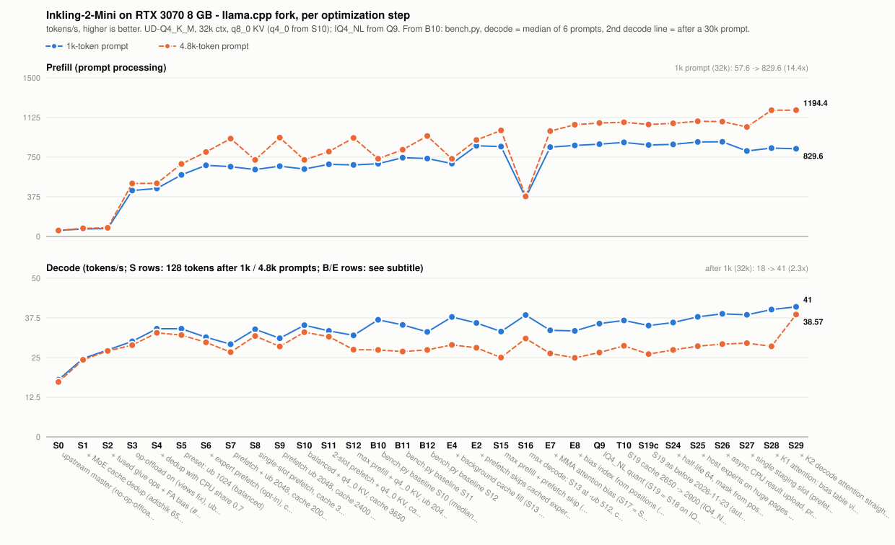

# Inkling-2-Mini perf log (fork branch `inkling-2-perf-improvement`)

RTX 3070 8 GB, Ryzen 5 5600X, 32 GB RAM. Unsloth `Inkling-2-Mini-UD-Q4_K_M`, 32k ctx, q8_0 KV, experts in RAM.
Every row is measured with `scripts/inkling-bench.sh` (one server session: greedy correctness check, then
~1k and ~4.8k token prompts with 128 generated tokens). Only rows that pass the correctness check are recorded.

The same numbers as a table: [progress-table.md](progress-table.md) (raw: [progress.tsv](progress.tsv)).

## ubatch x cache sweep (CPU share 0.7, commit 1410a556)

| -ub | cache MiB | VRAM peak | pp 1k | pp 4.8k | tg @1k | tg @4.8k |
|---:|---:|---:|---:|---:|---:|---:|
| 512 | 3400 | 7534 | 453.8 | 502.5 | 34.1 | 32.8 |
| 1024 | 3000 | 7354 | 575.6 | 669.3 | 33.0 | 30.9 |
| **1024** | **3400** | 7758 | **582.4** | **685.8** | **34.1** | **32.1** |
| 2048 | 2400 | 7226 | 548.5 | 776.3 | 30.8 | 27.8 |
| 2048 | 2800 | 7626 | 568.5 | 785.1 | 32.0 | 29.3 |

Recommended everyday preset:
`--fit off -ngl all -cmoe -b 2048 -ub 1024 --moe-cache-mib 3400 --moe-cache-cpu-share 0.7 -fa on -ctk q8_0 -ctv q8_0 -c 32768`
